# Exercise 2 - Monitor Solutions and Agents with Joule Studio

In this exercise, we will monitor deployed solutions and step into agent monitoring and traces

## Exercise 2.1 Solution Status

After completing these steps you will learn how to understand if the solution and comprising agent is running, deployment history and if invocations have been successful. 

1. Using a browser (preferably Chrome) launch Joule Work: https://747401964.eu10.sapdas.cloud.sap/new/conversations with ad161-XXX and the provided password

2. Select Joule Work > Joule Studio > Sentiment Agent
    
    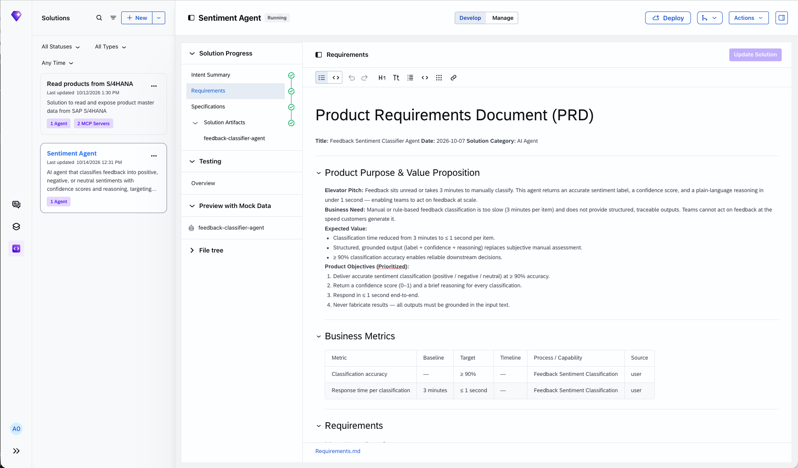

3. Switch from Develop to Manage and explore the status of the solution, completed runs & failures
     
     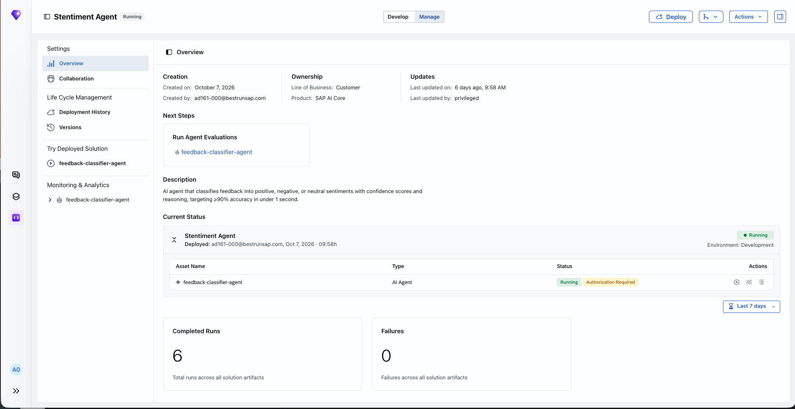
     
     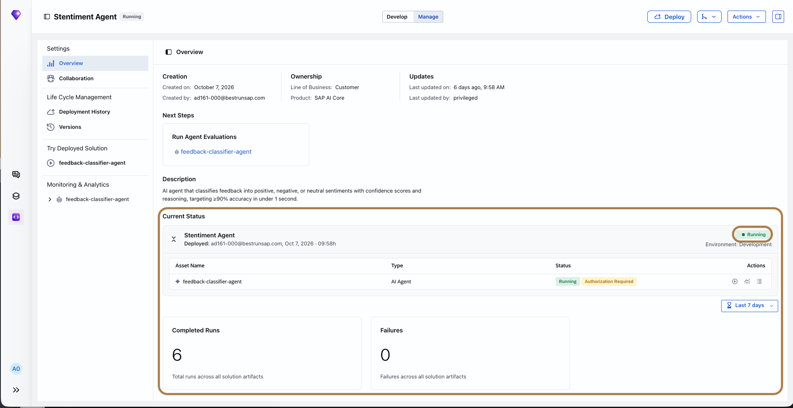

4. Try out the agent by clicking on 'Try Now' 
     
     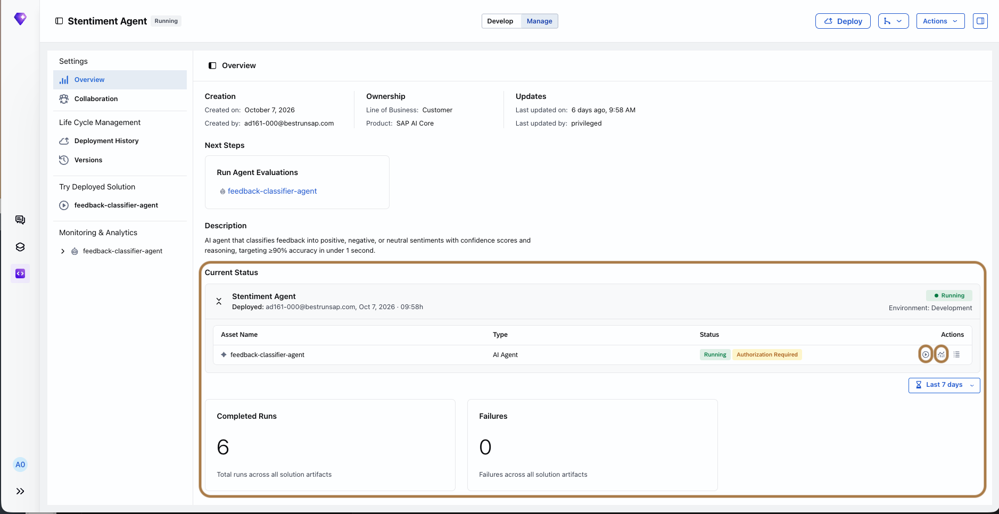

5. Interact with the agent with the following prompt `The latest application update causes the system to crash every time I open the reports tab. This bug is severely disrupting our daily workflow.`
       
       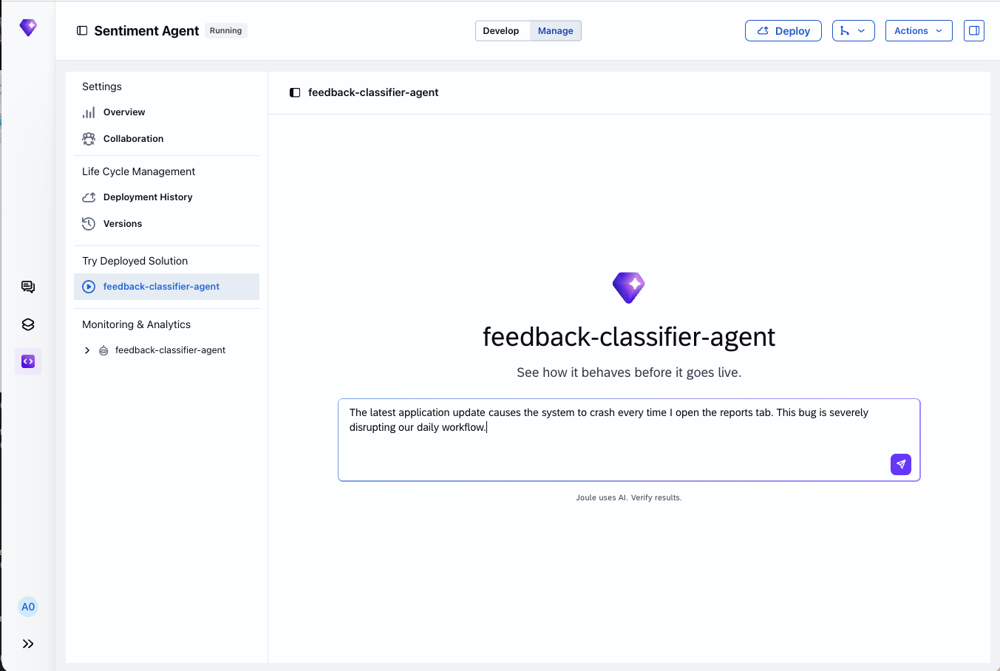
       
       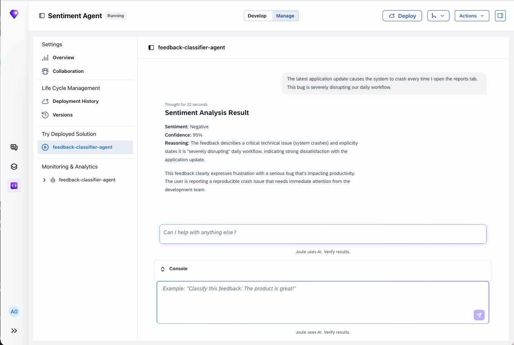

6. Select Deployment History to understand the past deployments and their status 
     
     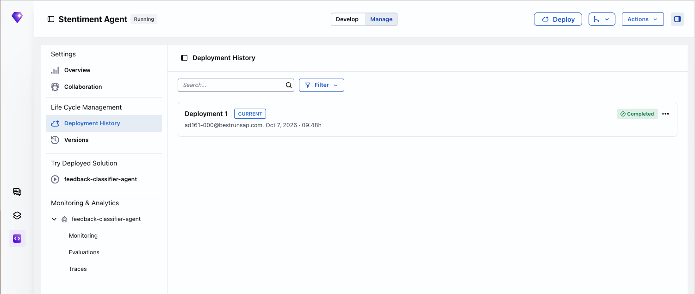

## Exercise 2.2 Agent Monitoring

After completing these steps you will learn how to monitor agents and get into details of a single invocation

1. Navigate into the deployed agent - feedback-classifier-agent > Monitoring and learn about aggregated information around the agent
     
     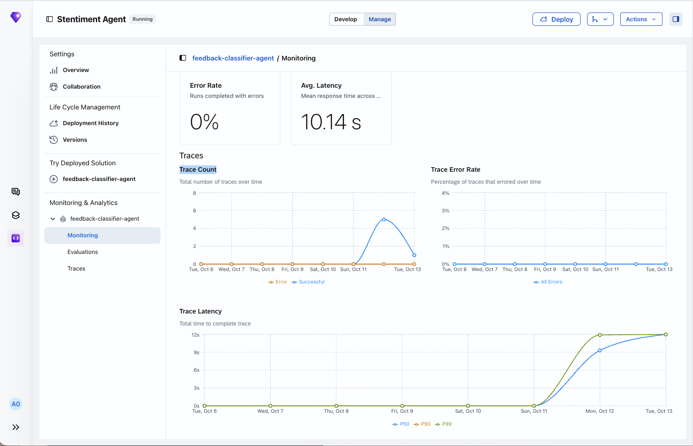

2. Navigate into the deployed agent - feedback-classifier-agent > Traces to learn about the indivisual invocations
     
     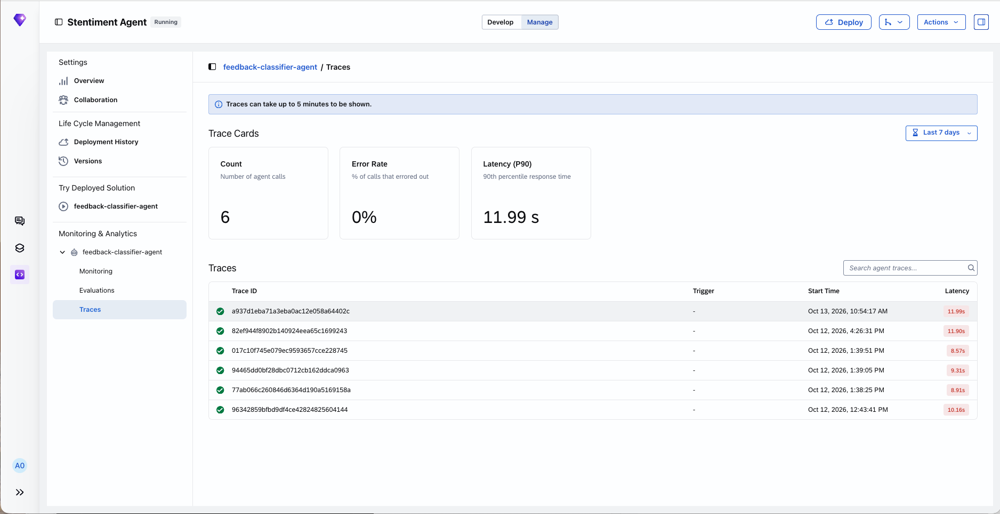

3. Navigate into the deployed agent - feedback-classifier-agent > Traces > Specific Trace to learn more about a single agent invocation
     
     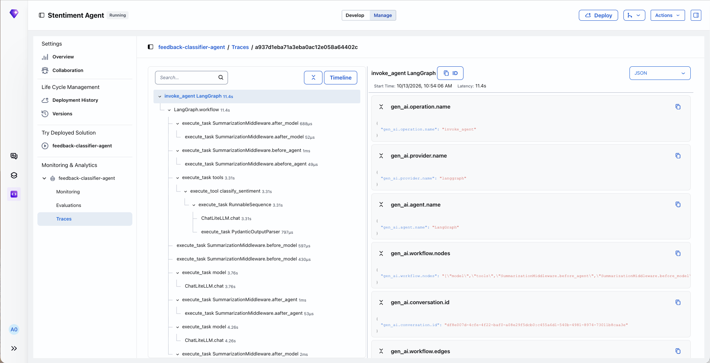

## 2.3 Solution Status and Agent Monitoring of Solution 'Read products from S/4HANA'

1. Select Joule Work > Joule Studio > Read products from S/4HANA
     
     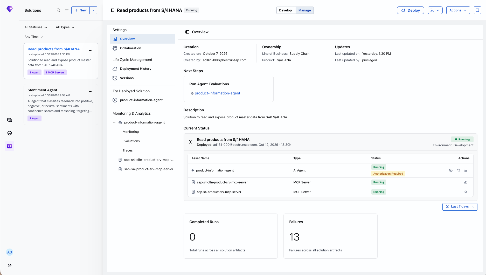

2. Observe the solution status, agent status, try it out and monitor the agent 'product-information-agent'
     
     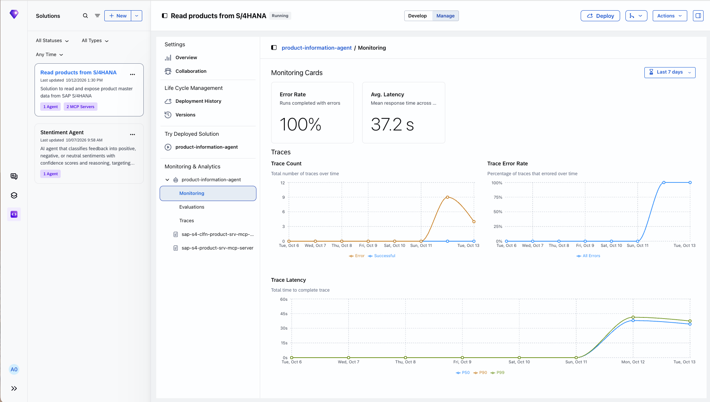

## Summary

You've now understand how to check the current status of the solution and it's artifacts. You know how to test out the solution and monitor a solution.

Continue to - [Exercise 3 - Build, Test, Deploy and Operate an agentic solution with Joule Studio](../ex3/README.md)
