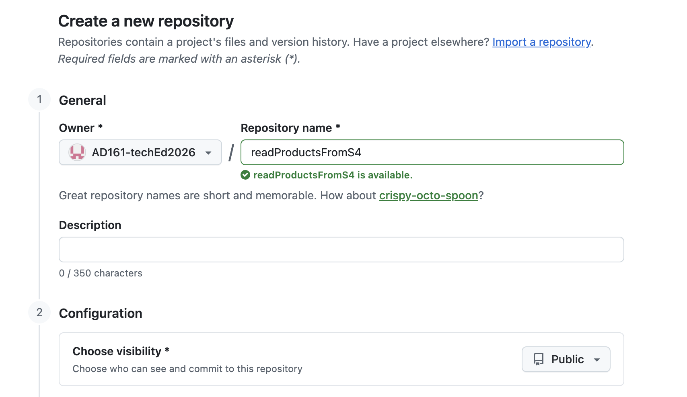
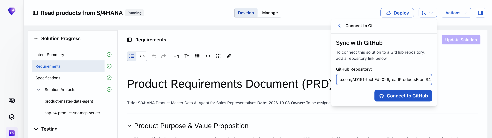
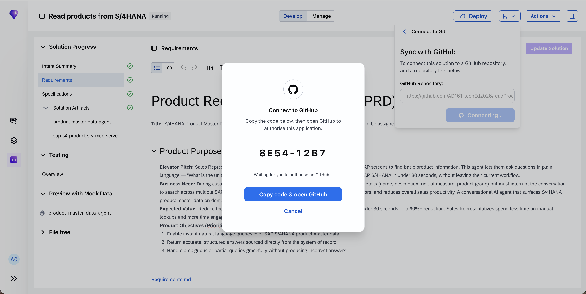
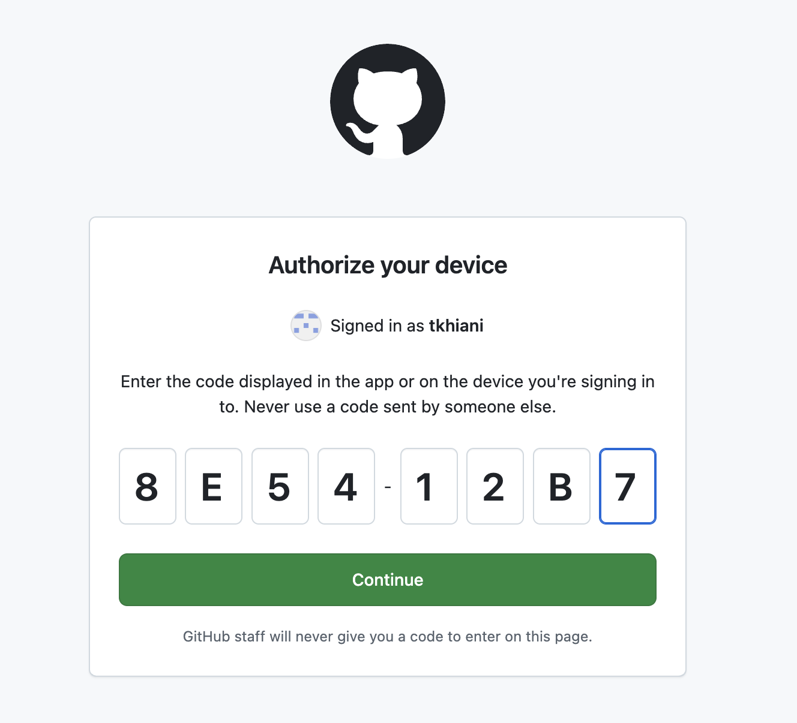
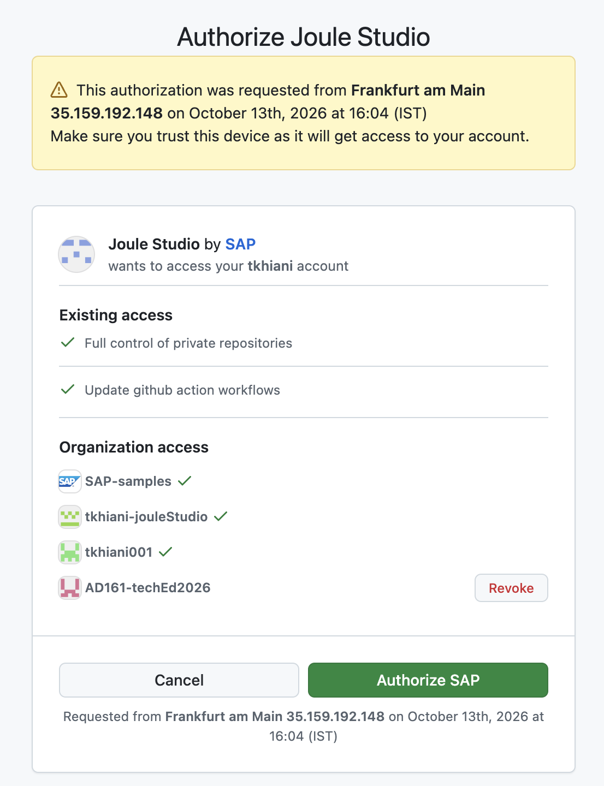
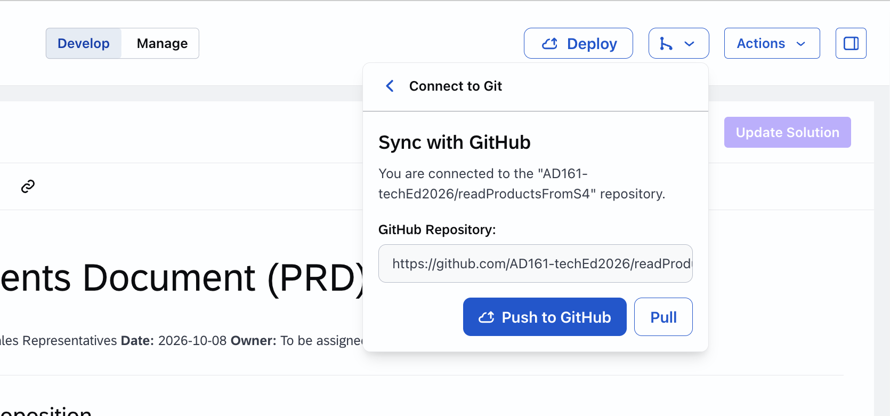
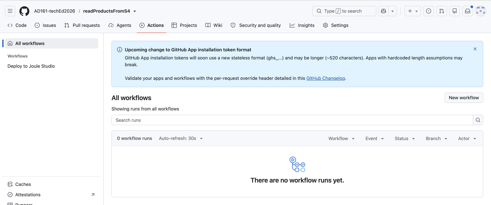
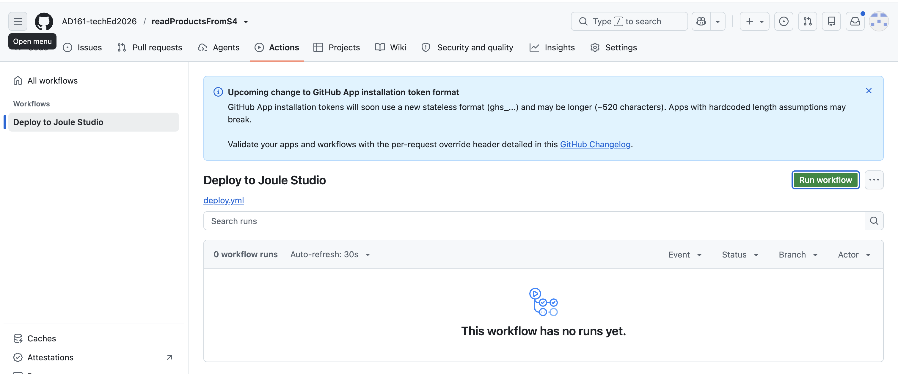
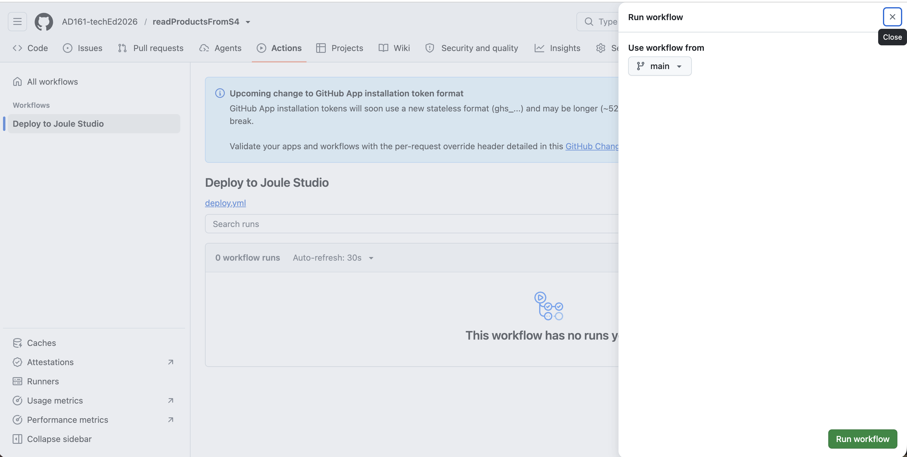

# Exercise 4 - (Optional) Push your agentic solutions to git and promote to production

In this exercise, we will push your solution to git and learn how to promote it to production

```
  Note: You would need a user in GitHub and an Organization to proceed with this exercise.  
```


## Exercise 2.1 Push Solution to Git

After completing these steps you will have learnt how to connect your solution to git and push changes to git

1. Navigate to https://github.com/ and create a public repository in a specific organization
      <br>
      <br>  

2. Navigate to your solution Joule Work > Joule Studio > `Your Solution`

3. Select `Connect to Git` > `GitHub` > Specify the GitHub Repository and click on `Connect to GitHub`
      <br>
      <br>  

4. Connect to GitHub by clicking on `Copy Code & open GitHub`
      <br>
      <br>  

5. Authorize your device and paste the code via CTR + V 
      <br>
      <br>  

6. Authorize SAP for the organization by click on `Grant` and then `Authorize SAP`
      <br>
      <br>  

7. Navigate back to Joule Studio and select `Push to GitHub`
      <br>
      <br>  


## Exercise 2.2 Promote your Solution

1. Navigate to your repository and Select `Actions`
      <br>
      <br>  

2. Select the action `Deploy to Joule Studio`
      <br>
      <br>  

3. Click on `Run Workflow` to trigger to deployment process
      <br>
      <br>  

    ```
    Note: The deployment job would fail as the needed configurations and the production landscape is not connected. For more details see https://help.sap.com/docs/joule-studio/joule-studio/promoting-solution-to-production.  
    ```


## Summary

You've now experienced how to connect a solution to git and promote to production. 

With the end of all expercises you are now in a position to create your agentic solution, test | deploy | monitor | promote to production. 
